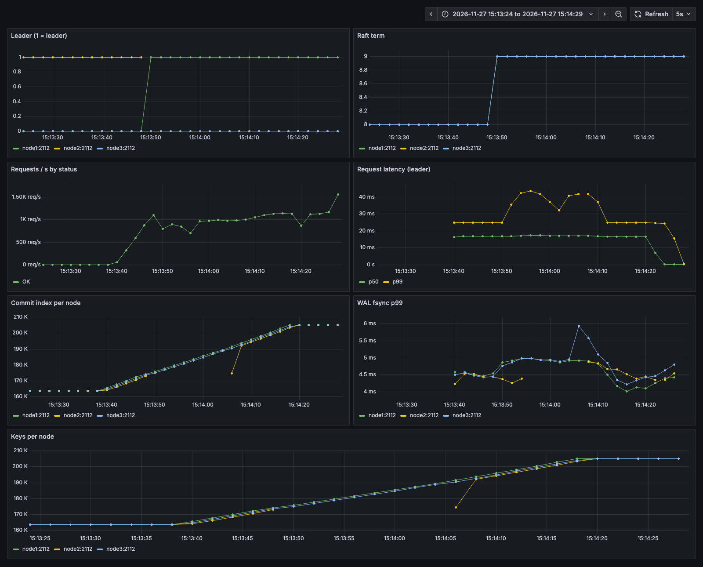

# dist-key-value-store

A distributed key-value store in Go, built from scratch: a write-ahead log, a
Raft-style replicated log with leader election, a gRPC API, Prometheus metrics,
a Docker cluster, k6 load tests and a chaos test that kills the leader under
load. It is intentionally a **compact Raft-style system I deeply understand**,
not a copy of the full Raft paper; see
[Raft guarantees: provided vs. not provided](#raft-guarantees-provided-vs-not-provided)
for exactly where the line is drawn.

## Results (Docker on a MacBook, 3 nodes, every write fsynced)

| Test | Result |
|---|---|
| **Chaos**: 16 writers for 40 s, leader hard-killed (`SIGKILL`) at 10 s, restarted at 25 s, 3 rounds in a row | **0 acknowledged writes lost** (~41,000 per round, ~1,000 writes/s), failover 0.4-1.1 s, all 3 nodes converge every round |
| **k6** gRPC load, 32 virtual users, Put + Get | 1,182 Put+Get pairs/s, p95 24 ms, 100% success |
| **k6**, 64 virtual users | 2,068 Put+Get pairs/s (~4,100 requests/s), p95 27.5 ms, 100% success |
| **Group commit** (same k6 test, 32 users) | before: 395 pairs/s, p95 76 ms, and a spurious leader election under load; after: 3x throughput, p95 24 ms, no elections |

Numbers are from `scripts/chaos.sh` and `scripts/k6.sh` on Docker Desktop; they
depend on the machine's fsync speed.



*One chaos run in Grafana: node2 (yellow) is the leader until it is killed at
15:13:47; node1 (green) takes over and the term moves from 8 to 9 (one election).
Writes keep flowing at ~1,000/s. node2's lines stop while it is down, then jump
back when it restarts at 15:14:02 and it catches up with the others. This run:
41,417 acknowledged writes, 0 lost, longest gap 408 ms.*

## What the chaos test found

The first version passed every unit test and the scripted demo, because the demo
only kills a node while nothing is being written. Killing the leader **under
load** showed three real problems:

1. **A restarted leader applied writes that were never committed.** A leader that
   is killed right after appending a write to its own WAL, before any follower has
   it, used to replay its whole WAL on restart *as if it were committed*. It then
   held keys no other node had (16 extra keys in one run).
2. **That node could never catch up**, because AppendEntries only compared against
   the follower's last entry, so a follower with a conflicting suffix was stuck
   forever. After two leader kills there was no longer a majority that could accept
   writes, so the cluster stopped accepting them.
3. **Under load, the leader missed heartbeats** (one fsync per write while holding
   the node's lock, plus one new RPC per write per follower), so followers started
   elections and deposed a healthy leader.

Fixes (each covered by a test in `internal/raft/conflict_test.go` or
`internal/store/rewrite_test.go`):

- **Commit before apply**: on restart, WAL entries rebuild the log but are applied
  only once a leader confirms they are committed.
- **Log matching with conflict truncation**: a follower checks the leader's entry at
  `PrevLogIndex`; on a term conflict it drops its uncommitted suffix (atomic WAL
  rewrite: temp file, fsync, rename, fsync dir) and takes the leader's entries.
  Conflicts skip back a whole term at a time.
- **No-op entry on election**: a new leader commits a no-op in its own term (which
  commits everything before it) and serves reads only after that.
- **Group commit + one replicator per follower**: waiting writes share one fsync;
  each follower has at most one AppendEntries in flight, batched (max 512 entries,
  one fsync per batch on the follower too).
- **No elections right after hearing from the leader**: a follower whose election
  timer fires while it is still busy with a slow fsync doesn't depose a live leader.

## What's in the repo

1. **Storage engine** ([`internal/store`](internal/store)): in-memory map + write-ahead
   log (WAL). Every write is fsynced before it is acknowledged. Startup replays the
   WAL; a torn or corrupted final record is detected via checksum and truncated.
2. **Raft-style replication** ([`internal/raft`](internal/raft)): terms, randomized
   election timeouts, `RequestVote`, `AppendEntries` with log matching and conflict
   truncation, majority commit, a no-op entry on election, group commit.
3. **gRPC API** ([`proto/kv/v1/kv.proto`](proto/kv/v1/kv.proto),
   [`internal/grpcapi`](internal/grpcapi)): `Put`, `Get`, `Delete`, `Status`. A
   follower answers `FAILED_PRECONDITION` with the leader's address in the
   `x-leader-addr` header. The original TCP + JSON client port still works.
4. **Metrics** ([`internal/metrics`](internal/metrics)): Prometheus `/metrics` with
   request rate and latency by method and status code, Raft term / leader / commit
   index, keys, and WAL fsync latency; a Grafana dashboard is provisioned.
5. **Docker** ([`Dockerfile`](Dockerfile), [`deploy/`](deploy)): a 3-node cluster plus
   Prometheus and Grafana with one `docker compose up`.
6. **Load and chaos tests**: [`load/k6-kv.js`](load/k6-kv.js) (k6 gRPC load test) and
   [`cmd/kvchaos`](cmd/kvchaos) + [`scripts/chaos.sh`](scripts/chaos.sh) (leader kill
   under load, then checks every acknowledged write and node convergence).
7. **CI** ([`.github/workflows/ci.yml`](.github/workflows/ci.yml)): vet, unit tests
   under the race detector, and the Docker chaos test on every push.

## Quick start (macOS / Linux, Docker)

```bash
docker compose -f deploy/docker-compose.yml up -d --build   # 3 nodes + Prometheus + Grafana
./scripts/chaos.sh                                          # kill the leader under load
./scripts/k6.sh                                             # k6 gRPC load test (VUS=64 ./scripts/k6.sh)
```

- Grafana: http://localhost:3001 (dashboard "KV cluster"), Prometheus: http://localhost:9090
- gRPC: `localhost:9001-9003`; metrics: `localhost:2112-2114/metrics`
- Reset all data: `docker compose -f deploy/docker-compose.yml down -v`

The original Windows/PowerShell demo below still works unchanged.

## Requirements

- Go 1.21+
- gcc (mingw-w64), **only** if you want to run `go test -race` -- not required for
  normal build/test/run

Run `.\scripts\check-env.ps1` to verify both; it prints exact install commands
(`winget`) for anything missing.

## Building & testing

```powershell
go build ./...
go vet ./...
go test ./...
go test ./internal/store/... -race -v   # requires gcc, see check-env.ps1
go test ./internal/raft/...  -race -v
```

## Running a single node

```powershell
go run ./cmd/node -id node1 -config .\scripts\cluster.json -data-dir .\data
```

Each node opens two TCP ports (from `scripts\cluster.json`): a **cluster port**
for Raft RPCs and a **client port** for Get/Put/Delete. The node's own stdin REPL
(`put`/`get`/`del`/`status`/`quit`) goes through the same leader-only path a
remote client would.

```powershell
go run ./cmd/kvctl -addr 127.0.0.1:8001 put color blue
go run ./cmd/kvctl -addr 127.0.0.1:8001 get color
```

## Running the full demo

```powershell
.\scripts\demo.ps1
```

Builds `node.exe`/`kvctl.exe`, starts 3 nodes in separate PowerShell windows, waits
for a leader, writes a key through it, shows a follower redirecting instead of
answering, hard-kills the leader with `taskkill /F /T`, shows the survivors elect a
new leader and keep serving reads and writes, restarts the killed node, and shows it
rejoin and catch up on what it missed. Runs start-to-finish in well under a minute
(typically ~10-15s). `scripts\run-3-nodes.ps1` is the simpler, non-scripted version
for just watching 3 interactive nodes and driving them by hand.

## Architecture

```
                     +-------------------+
                     |   cmd/kvctl (CLI) |
                     +---------+---------+
                               | TCP, client port (e.g. 8001)
                               v
   +----------------------------------------------------------+
   |                        cmd/node                          |
   |                                                            |
   |   internal/api.Server  <--- client Put/Get/Delete          |
   |         |  (leader-only; redirects via LeaderHint)         |
   |         v                                                  |
   |   internal/raft.Node  <---- RequestVote / AppendEntries    |
   |         |     ^                    (cluster port, e.g. 7001)
   |         v     |                                            |
   |   internal/store.Store (in-memory map + WAL)                |
   +----------------------------------------------------------+
                               ^
                               | internal/transport (TCP, length-prefixed JSON)
                               v
                     (same wiring on node2, node3)
```

The Raft log and the storage WAL are the same file: every WAL record carries
`Index`/`Term` in addition to `Op`/`Key`/`Value`, so replaying it on startup
rebuilds both the KV map and Raft's view of its own log in one pass. See
[Design Decisions](#design-decisions).

## Wire protocol

Clients can use gRPC (`proto/kv/v1/kv.proto`, see above). Node-to-node Raft RPCs
and the original TCP client port use the same simple framing
(`internal/transport/protocol.go`):

```
[4 bytes: uint32 big-endian length][payload: JSON]
```

```go
type Message struct {
    Type    string          `json:"type"`
    ID      string          `json:"id"`
    Payload json.RawMessage `json:"payload"`
}
```

Message types: `RequestVoteReq/Resp`, `AppendEntriesReq/Resp` (cluster port,
`internal/raft/rpc.go`); `ClientPutReq`, `ClientGetReq`, `ClientDeleteReq`,
`ClientResp` (client port, `internal/api/server.go`).

Each RPC is one request/response over a fresh, short-lived connection (dial, write,
read, close) bounded by a single timeout -- no connection pooling/multiplexing, so
failure modes stay easy to reason about.

## Node state machine

`Follower` -> (election timeout) -> `Candidate` -> (majority votes) -> `Leader`, or
back to `Follower` the moment any RPC or reply carries a higher term. See
`internal/raft/raft.go`'s package doc for the exact rules.

| Parameter | Value |
|---|---|
| Heartbeat interval (leader -> followers) | 100ms |
| Election timeout | random(300ms, 600ms), re-rolled on every reset |
| RPC dial+read timeout (per attempt) | 200ms |

These are roughly 2x the Raft paper's reference values (150-300ms / 50ms), to leave
margin for Windows scheduling/logging overhead during a live, narrated demo, while
still failing over in well under a second in practice.

`currentTerm`/`votedFor` are persisted to `data\<id>-raftstate.json` via
write-temp-then-`os.Rename` on every change, so a restarted node never double-votes
in a term it already saw.

## Milestones

Each of these was independently runnable and demoable on its own:

1. **Single-node store + WAL + crash recovery** (`internal/store`) -- in-memory map,
   WAL with checksums, torn-write/corruption detection and safe truncation.
2. **Concurrency + race tests** -- 100-goroutine mixed-op hammer test, clean under
   `go test -race`.
3. **TCP transport** (`internal/transport`) -- framing, timeouts, peer-disappears
   handling, plus a fake in-memory network for deterministic tests.
4. **Leader election** (`internal/raft`) -- terms, randomized timeouts,
   RequestVote, heartbeat AppendEntries, persisted term/vote.
5. **Replication + rejoin/catch-up** -- real log entries, majority commit, apply to
   state machine, leader-only client API with redirect, a restarted node catching up.
6. **Demo scripts + README** -- this file, `scripts\demo.ps1`.
7. **Production-style tooling + chaos fixes** -- gRPC API, Prometheus/Grafana,
   Docker Compose cluster, k6 load test, leader-kill chaos test in CI; then the
   fixes the chaos test forced (commit-before-apply, conflict truncation, no-op on
   election, group commit, per-follower replicators).

## Test strategy

| Area | How, deterministically, on Windows |
|---|---|
| WAL durability/corruption | In-process fault injection: truncate/corrupt bytes in a closed file, then reopen -- no subprocess, no timing dependency |
| Concurrent access | `go test -race` with many goroutines -- races are caught by instrumentation, not by observing a bad outcome |
| Transport framing/disconnects | Real TCP over loopback with short deadlines; disconnects triggered explicitly in-test |
| Election/partition/replication | A fake in-memory `Transport` (`internal/transport/fake.go`) with directional `Cut`/`Heal` instead of real network manipulation -- Windows firewall-rule partitioning needs admin rights and is slow/flaky. Real TCP is still exercised end-to-end by `demo.ps1` (that's what `taskkill` is for) |

## Design decisions

**1. Raft log vs. storage WAL: one file or two?** Unified -- the WAL record carries
`Term`/`Index`, so replaying it rebuilds both KV state and Raft's log view.
Alternative: separate log and WAL (cleaner separation of concerns) at the cost of
double the code and two fsyncs per write.

**2. Read consistency: leader-only vs. stale local reads.** Leader-only (followers
redirect via `LeaderHint`) -- simple to reason about and defend, no staleness
caveats. Alternative: any node answers reads from its own applied state (lower
latency, but explicitly non-linearizable).

**3. One TCP port vs. two per node.** Two -- a cluster port for Raft RPCs, a client
port for the KV API. Keeps logs legible and mirrors how real systems separate
internal and data-path protocols, at the cost of twice the listeners.

**4. Timer aggressiveness.** ~2x the Raft paper's reference values (see table
above) -- safer margin against Windows scheduling/logging jitter during a narrated
demo, while still failing over in well under a second.

## Raft guarantees: provided vs. not provided

**Provided:**
- Leader election with terms, randomized election timeouts, majority voting, and
  the up-to-date-log rule (a node votes only for a candidate whose log is at least
  as up to date as its own)
- Heartbeat-based leader liveness (`AppendEntries` with no entries)
- Log replication with full log matching (`PrevLogIndex`/`PrevLogTerm` at any
  index) and **conflict truncation** of a follower's uncommitted suffix
- Majority-acknowledged commits (a client write is acknowledged only once a
  majority of nodes, leader included, have it fsynced in their WAL), and only
  entries from the leader's own term are committed by counting replicas
- A **no-op entry** on election, so earlier-term entries commit; reads are served
  only after the leader's no-op commits
- Commit-before-apply on restart (WAL entries are not assumed committed)
- Persisted `currentTerm`/`votedFor` across restarts, so a restarted node cannot
  double-vote within a term it already saw
- Catch-up for a rejoining or stale follower in bounded batches

**Not provided (explicitly out of scope):**
- Log compaction/snapshotting: the log grows without bound, and a conflict
  truncation rewrites the whole WAL file (fine at this size, not for production)
- Cluster membership changes: the 3-node set is fixed at startup
- Linearizable reads under every leader-doubt scenario: reads go to the leader
  after its no-op commits, but there's no read-index/lease check, so a deposed
  leader that hasn't noticed yet could briefly serve a stale read
- Pre-vote: a node cut off from the leader can still raise its term and force an
  election when it reconnects
- Exactly-once writes: a client retry after an unclear failure (timeout) may apply
  the same put twice; puts are idempotent, so the final value is the same
- Byzantine faults

## Windows-specific notes

- **WAL file locking**: one long-lived `os.File` handle per node, all writes
  serialized through the store's mutex. Tests explicitly `Close()` before
  `os.Remove`, or Windows refuses with "process cannot access the file."
- **fsync**: `(*os.File).Sync()` maps to `FlushFileBuffers` on Windows -- genuinely
  durable, no special handling needed.
- **Ports**: bind to `127.0.0.1`, not `0.0.0.0` -- avoids an interactive Windows
  Defender Firewall prompt that would interrupt a live demo.
- **Process kill**: `taskkill /F /T /PID <pid>` is the Windows equivalent of
  `kill -9` -- ungraceful and uninterceptable, which is exactly what's needed to
  prove WAL recovery + Raft failover survive a real hard kill.
- `.ps1` scripts are kept plain-ASCII -- Windows PowerShell 5.1 misreads UTF-8
  em-dashes etc. in files without a BOM, which corrupts the parser in confusing,
  seemingly-unrelated ways.
