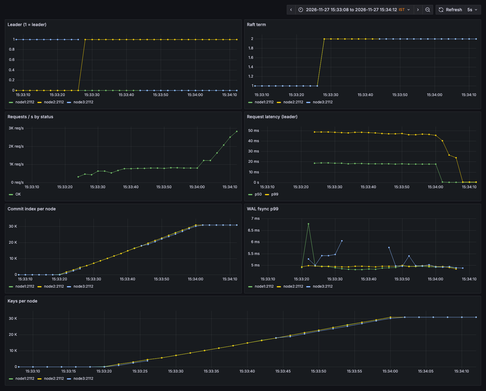

# Running the cluster on AWS EC2

Tested 27 Nov 2026 on a **t3.small** (2 vCPU, 2 GB RAM, 20 GB gp3) in `ap-south-1`
(Mumbai) with Amazon Linux 2023. One instance runs all three nodes plus Prometheus
and Grafana in Docker. That makes it a real cloud deployment of the same compose
file, but **not** a multi-machine cluster: a single instance is still a single
point of failure.

## Steps (AWS CLI, an IAM user with `AmazonEC2FullAccess`)

```bash
MYIP=$(curl -s https://checkip.amazonaws.com)
VPC=$(aws ec2 describe-vpcs --filters Name=isDefault,Values=true --query 'Vpcs[0].VpcId' --output text)
AMI=$(aws ec2 describe-images --owners amazon \
  --filters "Name=name,Values=al2023-ami-2023.*-x86_64" "Name=state,Values=available" \
  --query 'sort_by(Images,&CreationDate)[-1].ImageId' --output text)

aws ec2 create-key-pair --key-name kv-demo --key-type ed25519 \
  --query KeyMaterial --output text > ~/.ssh/kv-demo.pem && chmod 400 ~/.ssh/kv-demo.pem

# Only SSH and Grafana, and only from your own IP. The gRPC and metrics
# ports are never opened to the internet.
SG=$(aws ec2 create-security-group --group-name kv-demo-sg --vpc-id $VPC \
  --description "dist-kv demo: SSH and Grafana from owner IP only" --query GroupId --output text)
for p in 22 3001; do aws ec2 authorize-security-group-ingress --group-id $SG --protocol tcp --port $p --cidr $MYIP/32; done

aws ec2 run-instances --image-id $AMI --instance-type t3.small --key-name kv-demo \
  --security-group-ids $SG --user-data file://deploy/aws/ec2-user-data.sh \
  --block-device-mappings 'DeviceName=/dev/xvda,Ebs={VolumeSize=20,VolumeType=gp3,DeleteOnTermination=true}' \
  --tag-specifications 'ResourceType=instance,Tags=[{Key=Name,Value=dist-kv-demo}]'
```

`ec2-user-data.sh` adds 2 GB of swap (for the Go build), installs Docker, Docker
Compose and git, clones this repo and runs `docker compose up -d --build`. The
instance is ready about 3 minutes after launch. Grafana is then at
`http://<public-ip>:3001` (from your IP only).

## Results on the t3.small

| Test | Result |
|---|---|
| Chaos: 16 writers for 40 s, leader `docker kill`ed at 10 s, restarted at 25 s | 30,948 acknowledged writes (774/s), **0 lost**, failover 561 ms, all 3 nodes converged |
| k6, 32 virtual users, Put + Get | 830 pairs/s (~1,660 requests/s), p95 38 ms, 100% success |



*node3 (blue) leads until it is killed; node2 (yellow) takes over and the term
moves from 1 to 2. node3's lines stop while it is down, then it rejoins and catches
up. The spike in requests at the end is the checker reading back every
acknowledged write.*

## Don't get billed by accident

```bash
aws ec2 stop-instances --instance-ids <id>       # stops compute charges (the disk is still billed, a few cents a month)
aws ec2 terminate-instances --instance-ids <id>  # deletes it completely
```
